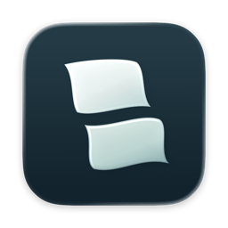
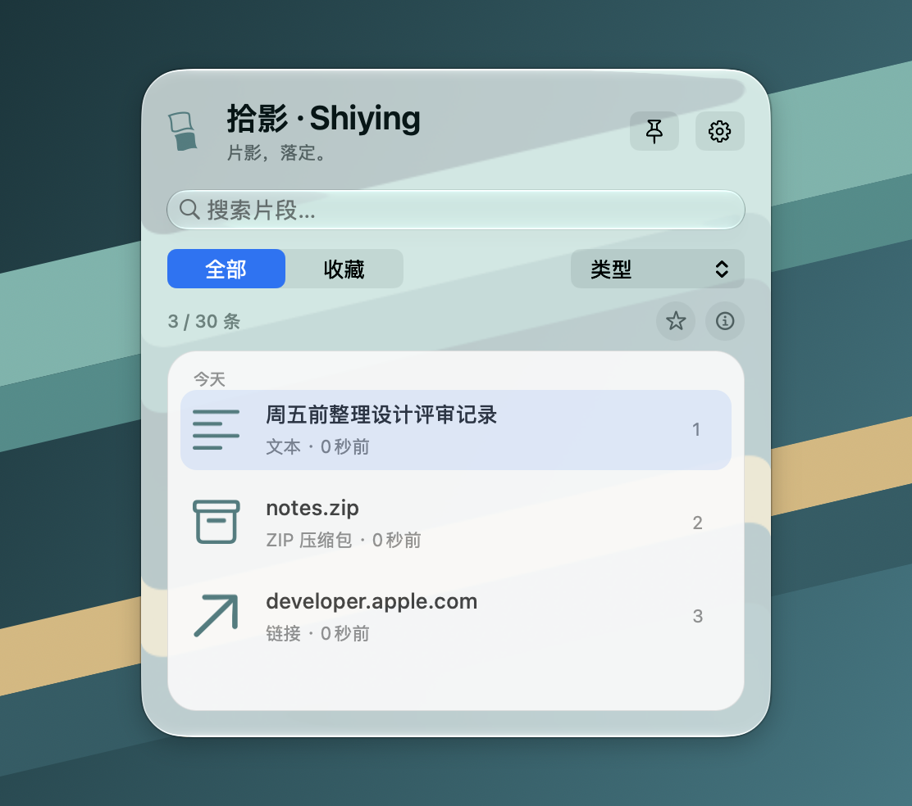
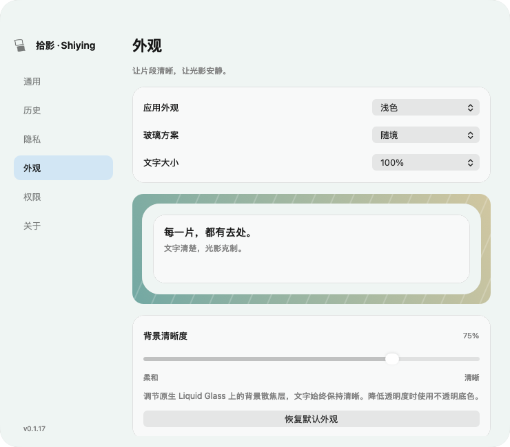

<div align="center">
  
  <h1>拾影 · Shiying</h1>
  <p>原生 macOS 剪贴板历史工具。按 <kbd>⌃V</kbd> 找回之前复制的文字、链接、图片和文件。</p>
</div>

## 系统要求

- 需要搭载 Apple 芯片的 Mac（`arm64`），系统为 macOS Tahoe 26.0 或更高版本。
- 从源码构建需要带有 macOS 26 或更新版 SDK 的 Xcode。本项目已在 Xcode 27.2 上构建。

## 使用方法

1. 启动拾影，在首次引导中开启剪贴板记录。
2. 如需持续在后台记录，在 **系统设置 → 隐私与安全性 → 从其他 App 粘贴**中，将拾影设为“始终允许”。
3. 复制一些内容，再按 **⌃V** 打开历史面板。双击条目或选中后按 **Return**，将内容放回系统剪贴板，然后在目标应用按 **⌘V** 粘贴。

全局快捷键可在设置中修改。菜单栏图标默认隐藏，可在通用设置中开启。

| 面板快捷键 | 操作 |
| --- | --- |
| ⌘K | 聚焦搜索框 |
| ⌘1 至 ⌘9 | 复制对应的可见条目 |
| ⇧⌘C | 以纯文本复制 |
| ⌘D | 收藏或取消收藏 |
| 空格 | 列表获得焦点时展开或收起详情 |
| Esc | 关闭面板 |

## 功能

- **历史与收藏。** 按内容搜索，按类型或收藏筛选。通常保留最近 30 条（含收藏）。当 30 条均为收藏时，额外保留最近 5 条。
- **多种剪贴板格式。** 支持纯文本、富文本、链接、常见图片格式，以及从 Finder 复制的文件和文件夹。一次复制多个文件会合为一条记录。可从详情或右键菜单在 Finder 中定位原文件。
- **面板与外观。** 支持拖动和临时固定，提供浅色与深色外观，以及简体中文和英文界面。

## 原生液态玻璃

拾影的主面板和设置中的材质预览使用 macOS 的原生 Liquid Glass，由 AppKit 的 `NSGlassEffectView` 渲染。窗口后方的颜色和纹理会透过玻璃，文字和控件保持清晰。点击图钉固定主面板后，切到其他应用时仍会保留活跃的玻璃外观。

<p align="center">
  
  <br>
  <sub>主面板 · 原生液态玻璃运行截图，背景清晰度为 100%，使用示例条目</sub>
</p>

在「设置 → 外观」中，可以选择随主题切换浅深配色的「随境」，或固定使用浅底深字的「清透墨字」。「背景清晰度」控制玻璃后方的模糊程度。macOS 开启「降低透明度」时，拾影会改用不透明衬底。

<p align="center">
  
  <br>
  <sub>外观设置 · 调整主题、玻璃样式和背景清晰度</sub>
</p>

## 隐私

拾影将历史保存在本机。历史内容和预览使用 AES-GCM 加密，密钥存于 macOS 钥匙串，时间、类型和收藏状态等元数据以明文存储。正式版的数据目录为 `~/Library/Application Support/com.shiying.mac/`。

文件条目只保存原文件引用。锁屏时暂停采集并清除已解密的预览。拾影会跳过带有敏感标记的剪贴板内容，未标记的密码或令牌仍可能进入历史。你可以在设置中排除应用或清空历史。

剪贴板通过定时检查采集。如果两次检查之间连续复制多次，可能只记录到最后一次。

## 从源码构建

1. 用 Xcode 打开 `Shiying.xcodeproj`。
2. 在 **Shiying → Signing & Capabilities** 中选择自己的开发团队，并使用对应的 Apple Development 签名。工程默认填写的是维护者团队。
3. 选择 **Shiying → My Mac**，按 **⌘R** 启动开发版。

工程使用 Swift 6、AppKit、系统 SQLite 和 CryptoKit，无需安装第三方包或重新生成 Xcode 工程。开发版使用独立的偏好、历史和钥匙串条目。

在项目根目录运行以下脚本可构建 Debug 版和执行测试，脚本需要 Python 3。

```sh
./Scripts/build.sh Debug
./Scripts/test.sh
```

脚本默认使用 `/Applications/Xcode.app`，可通过 `DEVELOPER_DIR` 指定其他 Xcode。测试也可以在 Xcode 中按 **⌘U** 运行。

## 本地打包

配置有效的 Apple 签名后，运行 `./Scripts/build.sh Release`。脚本会更新本机的 `/Applications/Shiying.app`，并在 `dist/Latest/` 生成 ZIP、DMG 和校验文件。对外分发安装包需使用 Developer ID 签名并完成 Apple 公证。

固定面板的玻璃效果目前依赖一个未公开的 AppKit 接口。升级 macOS 后应重新验证该效果，提交 Mac App Store 前需要迁移到公开接口。
