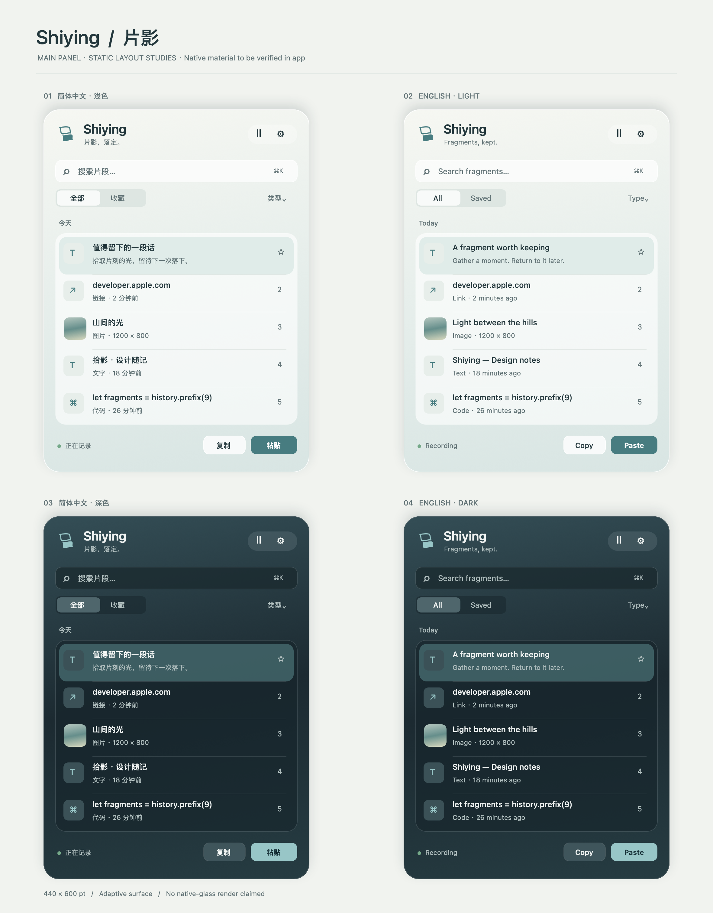
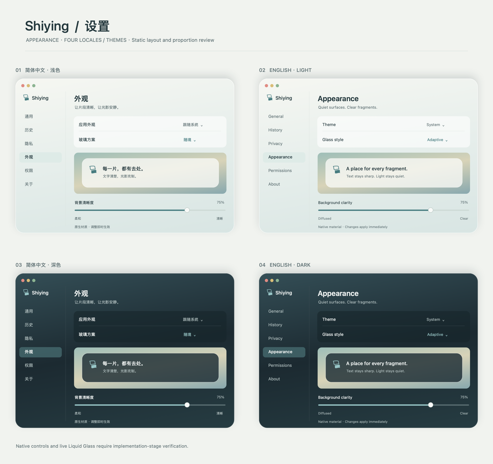
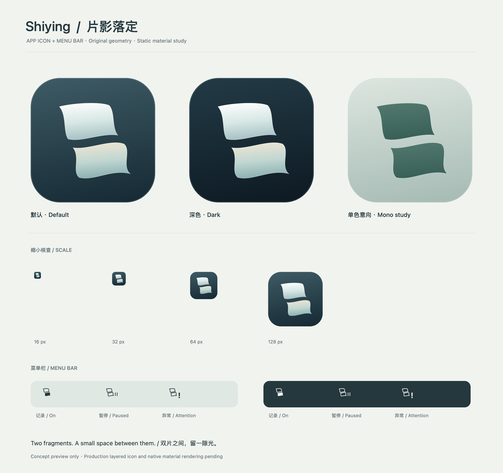

# 拾影 Shiying · UI 与图标设计稿

> 片影，落定。 / Fragments, kept.

版本：v1.0 · 2026-11-05。配套需求：[产品功能与技术栈](Shiying-产品功能与技术栈.md)。本文定义设计与实施目标，不能作为已开发功能或原生渲染验收完成的证明。

## 最高原则：第一是轻量，第二是实现约定功能

**Shiying 的第一优先级是轻量，第二优先级是完整实现约定功能。以最简洁的架构、最小的应用包和最低的必要运行开销完成交付。这是全部技术、功能、界面和图标决策的最高约束。**

- **设计采用最小原生实现**：优先系统控件、字体、SF Symbols 和 Apple 原生材质，减少自定义视图、重复图层与不必要的界面框架；简洁同时体现在画面与实现中。
- **在轻量预算内落实美感**：用准确比例、留白、层级和克制的材质建立品质，不靠大型图片、字体包、装饰性视频、复杂着色器或持续动画增加体积与功耗。
- **完整实现当期功能**：主面板、设置、提示、双语、权限与辅助功能均按约定行为交付，不以展示稿或无效控件代替实现；按产品文档 P0／P1／P2 分期，不一次加入全部扩展。
- **资源与图层按需存在**：窗口关闭后停止动画和预览刷新；复用组件与几何路径，控制玻璃层、遮罩及滤镜数量；四种玻璃方案共享实现，不复制四套页面。
- **图标与交付资源最小化**：应用图标按系统要求生成必需资源，菜单栏图标复用同一母形；参考图、评审图、生成工具和多余导出文件不进入应用包。
- **持续实测与收敛**：遵守产品文档 arm64 `.app` ≤ 5 MB、ZIP ≤ 3 MB 的目标，并持续向更小优化；视觉方案同时测量内存、CPU、GPU 与能耗。先减少冗余资源、依赖和重复实现，保留权限校验、隐私保护、异常恢复与约定功能。

## 1. 视觉理念：片影

“拾”是把流散的片段轻轻收起，“影”是原物留下的另一种存在。界面的基本形态因此是薄片、留隙和轻微错位：片段进入列表时获得一个安静的位置，被再次使用时离开面板，落入当前工作。意象留在比例与层次中，日常按钮使用明确的“复制”“粘贴”，不要求用户理解隐喻才能操作。

空间以舒展的呼吸感组织。品牌区短而清楚，搜索居于内容之前，历史列表是视觉重心。轮廓与分隔线经过细致校准，避免每条记录都像独立漂浮的卡片。以统一容器承接碎片，让页面像一小块被安放好的工作空间。

材质只承担边界与深度。外壳接住环境光，阅读区域稳定承接文字，按钮和文本始终清晰。浅色像温润的雾银，深色像带有微光的夜墨；色彩只在选中、焦点和必要状态中出现。美感来自克制的透明、准确的灰阶与精细的像素对齐。

动效表达收取与落定，幅度小、时间短、可被打断。展开不弹跳，记录更新不牵动正在阅读的位置，关闭不拖延粘贴。界面不持续发光、不漂浮、不播放装饰动画；安静是使用方式，不只是画面风格。

图标由两枚共享曲率的薄片构成：后片略高且轻，前片略低且实，两者间保留一道空气。它们不是栖明双翼的复制，而是同一家族中另一种姿态。细小尺寸仍保有清晰的正负形，使品牌既能存在于 1024 像素的图标，也能落在菜单栏的十余点之内。

## 2. 参考转译与交付范围

### 2.1 从截图借鉴什么

用户提供的栖明截图采用圆润玻璃外壳、左侧品牌、右侧控制胶囊、统一分组容器与组内细线分隔。拾影保留这些秩序，改用适合历史检索的列表结构。

- 品牌区收敛为小标记、Shiying 与一句简短副标题，不照搬截图中的大字号和文本投影。
- 工具胶囊仅放“暂停记录”和“设置”；状态点与文字配对。退出入口放进菜单，避免把电源符号误解为停止当前任务。
- 列表共享一个阅读衬底，记录之间细线分隔；选中才出现轻微色块，不叠加一排玻璃镜片。
- 不复制截图中的电源策略开关；历史行是可选择的记录，不是功能开关。
- 玻璃保留环境色，但不让背景上的文字透进来与正文竞争。默认界面不使用白字加重投影维持可读性。

### 2.2 本轮交付

| 文件 | 内容 | 验证属性 |
| --- | --- | --- |
| 本 Markdown | 布局、组件、交互、玻璃映射、双语、图标与验收规范 | 设计依据 |
| [主面板四组预览](Shiying-design-assets/Shiying-main-four-variants.png) | 中文浅色／英文浅色／中文深色／英文深色 | 静态排版概念稿 |
| [设置四组预览](Shiying-design-assets/Shiying-settings-four-variants.png) | 同一套设置结构的四组预览 | 静态排版概念稿 |
| [应用与菜单栏图标稿](Shiying-design-assets/Shiying-icon-study.png) | 默认、深色、单色意向及菜单栏状态 | 静态几何与材质概念稿 |

**本轮 PNG 通过 AppKit 二维绘图生成，没有运行拾影应用，也没有截取真实 NSGlassEffectView。** 图中的材质明暗是设计表达；实际折射、桌面采样、系统控件、辅助功能和窗口焦点须完成第 11 节实机矩阵。预览中的线性小图形为示意，正式控件优先 SF Symbols。设计图不打包进应用。

## 3. 信息架构与默认尺寸

主入口：菜单栏 → 主面板 → 搜索／选择 → 粘贴或再次复制。设置是独立原生窗口；预览默认在主面板底部展开，不再打开第二个漂浮玻璃窗口。

所有尺寸单位为 **pt**，预览输出像素不等同于系统实际点数。

| 项目 | 默认值 | 自适应规则 |
| --- | --- | --- |
| 主面板 | 440 × 600 | 宽 400–560；高度不超过当前屏幕可见区减 32，超出滚动 |
| 外壳圆角 | 26 | 系统窗口遮罩和原生材质允许的范围内统一 |
| 内容水平内边距 | 20 | 小屏不低于 16 |
| 品牌区 | 高 64 | 标记 28，品牌 20 pt semibold，副标题 11 pt |
| 搜索框 | 高 36 | 原生 NSSearchField，随内容宽度伸展 |
| 筛选行 | 高 30，与搜索间隔 12 | 默认只显示“全部／收藏”分段，类型由右侧弹出菜单选择，避免英文六标签拥挤 |
| 时间分组标题 | 高 28 | “今天 / Today”“更早 / Earlier”，只在切组时显示 |
| 文本记录 | 最小高 64 | 标题一行、摘要一行；大字号时自适应增高 |
| 图片／文件记录 | 最小高 72 | 40 × 40 缩略图，保持比例、不裁掉关键内容 |
| 行内边距 | 左右 12，上下 10 | 类型图标 18，正文间距 10，尾部收藏／序号区 28 |
| 底部操作区 | 最小高 44 | 左边记录状态，右边“复制”“粘贴”；不因文案变长挤压正文 |
| 详情展开 | 增高最多 160 | 上方列表缩至至少 3 行；小屏改独立非浮动预览窗口 |
| 设置窗口 | 740 × 560，最小 680 × 480 | 左栏 156，右侧内容水平内边距 28；右侧可纵向滚动 |

节奏采用 4／8／12／16／20／24／32。细线按当前 backingScaleFactor 对齐一个物理像素；不全局硬编码 0.5 pt。

### 主面板结构

```text
┌────────────────────────────────────────────┐
│  双片标记  Shiying             [Ⅱ] [⚙]     │
│            片影，落定。                    │
│  [ 搜索片段…                         ⌘K ] │
│  [ 全部 | 收藏 ]                  类型 ▾  │
│                                            │
│  今天                                      │
│  ┌──────────────────────────────────────┐  │
│  │ T  论文段落                     ☆ 1 │  │
│  │    一段文字的预览                    │  │
│  ├──────────────────────────────────────┤  │
│  │ ↗  developer.apple.com             2 │  │
│  │    链接 · 2 分钟前                   │  │
│  ├──────────────────────────────────────┤  │
│  │ ▧  山间的光                       3 │  │
│  │    图片 · 1200 × 800                 │  │
│  └──────────────────────────────────────┘  │
│  正在记录                   [复制] [粘贴]  │
└────────────────────────────────────────────┘
```

实际搜索框用系统搜索图标，图示中的 T／↗／▧ 仅表达类型。`⌘K` 为面板内聚焦搜索提示；全局唤出快捷键由用户配置，不混用两者。



## 4. 主面板细节与交互

### 4.1 顶部与工具胶囊

- 左侧单色品牌双片标记 28 pt，与品牌基线及右侧工具胶囊光学居中。统一使用 Shiying，避免语言切换时品牌区重新排版。
- 副标题中文“片影，落定。”；英文“Fragments, kept.”，只出现于品牌区，不占用列表内容空间。
- 右侧两个 28 × 28 命中区，共享一个低对比玻璃胶囊；暂停图标有 tooltip 和 VoiceOver 标签，暂停后换成继续图标。
- 单次点击只处理一次；点击窗口外部与 Escape 收起，面板关闭不改变采集状态。

### 4.2 搜索、列表与选择

- 快捷键唤出后搜索获得键盘焦点，空查询时选择第一条；菜单栏点击打开也可直接输入。
- 记录标题优先用用户标题，否则用内容首行；第二行展示摘要或类型尺寸信息。可能来源在详情中显示，不在每一行重复应用图标。
- 主列表显示紧凑时间，精确时间在详情；预览文案不暴露完整文件路径，详细路径由用户主动展开。
- Hover：中性浅填充，且不改变键盘选择；Selection：柔和系统强调色背景和清楚的文字对比；Keyboard focus：由原生焦点环单独表达。
- 单击选择，Return 执行当前可用的默认动作，双击使用该条；明确按钮始终可用。Return 为默认动作，不另绑定系统“确认删除”。
- `⌘C` 将所选记录写回剪贴板；`⇧⌘C` 以纯文本复制；`Space` 展开／收起详情。组合键须在实现时检查输入法与系统冲突。
- 删除优先使用上下文菜单或 `⌘⌫`，只在列表具有焦点时生效；搜索框内 `⌘⌫` 保留文本编辑语义。
- 新记录到达时，若用户正在搜索、翻阅或已选择旧条目，不抢焦点、不跳到顶部；显示轻量“有新片段”入口。
- 空间不足时隐藏副标题和非必要快捷提示，保留搜索、结果、核心动作及状态，不能靠缩小到不可读字号解决。

### 4.3 详情与反馈

- 文本使用系统正文，代码可切至系统等宽字体；支持选择复制。显示截断与“查看完整内容”入口，不在列表渲染全部大文本。
- 图片按容器适配，展示尺寸与格式；文件显示名称、引用有效性及“在 Finder 中显示”，无效时禁用该动作。
- 敏感预览关闭时显示“内容已隐藏 / Content hidden”，用户主动查看后再解密；切换条目与关闭面板清除该预览。
- 自动粘贴可用：主按钮“粘贴 / Paste”，次按钮“复制 / Copy”；无权限时主按钮改“复制 / Copy”，旁边提供轻量“启用粘贴 / Enable Paste”入口。
- 自动粘贴后收起面板；若用户配置保持面板，则短暂显示“已发送粘贴操作 / Paste command sent”。复制反馈为“已复制 / Copied”，不使用无法证明的“粘贴成功”。

## 5. 设置窗口

设置采用单个原生窗口和左侧导航，不把每个分组都做成高折射的玻璃小卡。外壳继承主面板材质，右侧表单有稳定阅读衬底，开关与下拉菜单使用系统控件。

| 导航 | English | 包含内容 |
| --- | --- | --- |
| 通用 | General | 登录启动、全局快捷键、默认动作、语言 |
| 历史 | History | 常规 30 条、满收藏时额外 5 条滚动缓冲、重启保留说明、容量、收藏规则、清理入口；无按天过期或任意扩容设置 |
| 隐私 | Privacy | 记录开关、排除应用、敏感标记、预览隐藏、加密与密钥状态 |
| 外观 | Appearance | 系统／浅色／深色，四种玻璃方案、清晰度、即时预览 |
| 权限 | Permissions | 剪贴板访问、辅助功能、登录项，状态与系统设置入口 |
| 关于 | About | 品牌、版本、官网、诊断与许可说明 |

- 首版导航项只承载已实现功能；P1／P2 不以可点击但无效的控件提前占位。
- 表单分组间距 24，行高最小 44，标签 13 pt，说明 11–12 pt；长英文说明自然换行，右侧控件有最小宽度。
- 语言使用下拉菜单“跟随系统 / System、简体中文、English”；自身语言名称保持自称。切换立即更新窗口，保持当前页、搜索、所选记录和采集状态。
- “外观”页包含 4 方案选择、约 440 × 160 的静态内容预览与“背景清晰度”滑杆；滑杆作用有说明，非透明度百分比。
- 主界面默认 **“随境 / Adaptive”**，即借鉴 Qiming `optimized` 的语义前景与局部阅读衬底；不直接沿用 Qiming 默认白字灰卡。
- 数据删除放在历史页底部独立区域，不与保存、关闭等常用按钮并排；删除历史与清空当前系统剪贴板是不同动作。
- 历史页常驻说明：“常规保留 30 条；全部收藏后，额外保留最近 5 条。重启后仍可使用，不按天数过期。”／“Keep up to 30 items. When all 30 are saved, keep 5 additional recent items. History survives restarts and doesn’t expire by age.”；历史来源为本地持久存储，不要求系统当前剪贴板保留。
- 显示占用“18 / 30 条 · 收藏 3 条”／“18 / 30 items · 3 saved”，常规上限为 30；缓冲模式显示“收藏 30 / 30 · 缓冲 3 / 5”／“Saved 30 / 30 · Recent 3 / 5”，总上限 35，不能另显示不受限的收藏库；容量单独列出，不用数量代替字节大小。
- 常规 30 条满额时不弹确认打断正常复制，按规则淘汰最旧非收藏；全部收藏后自动启用 5 条缓冲，继续滚动，不以错误态提示。容量无法容纳时才说明未保存新内容，并提供“管理收藏 / Manage Saved Items”；不能显示虚假的“已保存”。
- 应用外观选择只作用于拾影，不修改 macOS 系统外观；系统强调色默认跟随用户，不强制品牌色覆盖系统控件。
- 缓冲区沿用现有列表，只加“最近缓冲 / Recent Buffer”分组标题，无需新窗口或重型组件；搜索和全部视图包含缓冲，收藏筛选不包含未收藏的缓冲内容。缓冲同样重启保留。
- 收藏上限为 30；尝试收藏缓冲记录时说明先取消已有收藏。取消／删除收藏导致退出缓冲且需要淘汰多条时，原生确认框显示实际删除条数，例如“将回到 30 条历史，并移除最旧的 5 条非收藏记录”；用户取消则不执行原操作。



## 6. 提示、空状态与边界状态

| 场景 | 中文 | English | 呈现与动作 |
| --- | --- | --- | --- |
| 首次无记录 | 每一片，都有去处。 | A place for every fragment. | 双片线稿、简短解释、明确“开始记录 / Start Recording”按钮 |
| 搜索为空 | 没有找到相关片段 | No matching fragments | 保留输入与筛选，“清除筛选 / Clear Filters” |
| 暂停 | 已暂停记录 | Recording paused | 顶部状态或一行轻提示；“继续 / Resume” |
| 剪贴板访问被拒绝 | 需要剪贴板访问权限 | Clipboard access required | 持续状态行与“前往设置 / Open Settings”，历史仍可浏览 |
| 无自动粘贴权限 | 已复制，请按 ⌘V | Copied. Press ⌘V to paste. | 不重复弹窗；明确辅助功能仅为自动粘贴所需 |
| 条目超限 | 此片段超过保存上限 | This fragment exceeds the size limit | 非模态提示，可查看上限设置；不保留残缺记录冒充完整 |
| 存储不可用 | 暂时无法保存新片段 | New fragments couldn’t be saved | 显示暂停原因，保留已存历史，提供诊断入口 |
| 文件引用失效 | 原文件不可用 | Original file unavailable | 该行状态图标与详情，不修改或删除源文件 |
| 密钥不可用 | 暂时无法读取加密内容 | Encrypted content is unavailable | 不露正文，不自动清空历史，提供重试与帮助 |
| 清空确认 | 清空全部历史？ | Clear all history? | 原生 alert；说明包含收藏，默认“取消 / Cancel”，破坏性按钮明确命名 |
| 30 条全收藏 | 已启用 5 条滚动缓冲 | 5-item rolling buffer enabled | 中性状态，继续采集；显示“收藏 30 / 30 · 缓冲 n / 5”，不显示为暂停或异常 |

- 每次只显示一个主要告警；同类错误合并，状态变化才更新，不用反复通知维持注意力。
- 非阻塞反馈持续约 1.5 s；持久故障保持可见。关键状态不能仅靠颜色或短暂 toast 表达。
- 初次引导解释“记录范围—本地保存—随时暂停”，不先弹出所有权限；自动粘贴权限等用户首次触发相关功能时再请求。

## 7. 色彩、文字与细节规范

下列 HEX 是设计稿的校准基准。正式应用优先 `labelColor`、`secondaryLabelColor`、`separatorColor`、系统强调色等语义颜色；玻璃上的可读性按真实合成结果测量。

| Token | 浅色 | 深色 | 用途 |
| --- | --- | --- | --- |
| `ink.primary` | #24383D | #F0F3F2 | 标题与正文参考 |
| `ink.secondary` | #637477 | #AFBDBD | 摘要、状态与时间参考 |
| `surface.reading` | #F5F7F4 | #202D32 | 内容衬底参考，不作为整窗固定透明贴图 |
| `accent.brand` | #477C80 | #98C6C7 | 品牌与设计预览，系统选择控件仍跟随用户强调色 |
| `accent.warm` | #C5B08C | #D1BE9D | 仅用于应用图标内片微光 |
| `line` | #DCE4E0 | #415056 | 分隔与轮廓参考 |

- 系统字体：标题 20 semibold，行标题 13 medium，正文 13 regular，辅助文案 11–12 regular；中文用系统中文字体回退，不捆绑字库。
- 不用 ultralight 承载正文；不大段居中、不在列表显示诗意长句、不对所有文字加阴影。
- 阅读衬底按真实背景调校，不把固定 alpha 当作对比度保证。普通文字目标至少 4.5:1，大字及必要图形目标至少 3:1；控件边界和焦点同样验证。
- 所有可点击图标最小命中区 28 × 28 pt；常用按钮高 28–32 pt。视觉图标可以更小，命中范围不缩小。
- 按钮标题完整显示，英文不足空间时增加宽度、换行说明或移动次要操作，不随意缩写成难懂单词。

## 8. 原生 Liquid Glass 与栖明四方案映射

### 8.1 读过的代码与职责

| 栖明参考文件 | 本次观察到的实现 | 拾影借鉴与调整 |
| --- | --- | --- |
| [GlassSurfaceView.swift](/Users/fanyulong/Desktop/Qiming/Qiming/UI/GlassSurfaceView.swift) | `grayCards`、`grayUniform`、`backupBlack`、`optimized`；`NSGlassEffectView.style = .clear`；背景专用滤镜与阅读衬底分层 | 保留统一宿主和四种策略；拾影默认 adaptive，正文不统一强制白色 |
| [Components.swift](/Users/fanyulong/Desktop/Qiming/Qiming/UI/Components.swift:498) | `GlassCardLens` 与 `ReadableLabel`，白墨方案有细小阴影 | 复用“光学背景不截获事件”的原则；历史行用单组阅读衬底，正文默认无阴影 |
| [PanelController.swift](/Users/fanyulong/Desktop/Qiming/Qiming/UI/PanelController.swift) | 透明滚动内容、视图可见时更新、按状态重建 | 保留可见性管理与局部更新；不移植电源会话及倒计时刷新逻辑 |
| [GlassPopover.swift](/Users/fanyulong/Desktop/Qiming/Qiming/UI/GlassPopover.swift) | 透明 borderless nonactivating NSPanel、锚点校验、20/16 百分之一秒展开收起、点击外部关闭 | 复用窗口定位与可中断过渡原则，增加搜索焦点、先前应用恢复与输入法验证 |
| [SettingsController.swift](/Users/fanyulong/Desktop/Qiming/Qiming/UI/SettingsController.swift:178) | 方案选择、0–1 连续滑杆、预览、恢复默认 | 提供等价设置；用“背景清晰度”解释它主要控制背景散焦而非整个窗口透明度 |

**这四种方案是 Qiming 自定义组合，不是 Apple 提供的四个 Liquid Glass 系统预设。** 引入代码前按拾影数据流拆分依赖与命名，不能直接复制整个电源应用模块。

按本次要求，原生 Liquid Glass 支持提升为 **P0 首版要求**；默认随境及四方案设置均按本设计稿实现，包体与能耗仍遵循原预算。

### 8.2 四方案的拾影命名与默认

| Qiming 标识 | 拾影中文／英文 | 拾影表现 | 适用与限制 |
| --- | --- | --- | --- |
| `grayCards` | 雾银分组 / Mist Groups | 外部清透，每个功能组共享灰银衬底，亮色前景 | 最接近参考截图；列表只一块组衬底，避免每行再套镜片 |
| `grayUniform` | 雾银整面 / Mist Surface | 整面均匀雾银，亮色前景 | 轮廓更安静；需足够暗的衬底，不把白字放在接近白色玻璃上 |
| `backupBlack` | 清透墨字 / Clear Ink | 清透外壳、深色字、浅色局部阅读区 | 偏浅色阅读；深色系统下也提供浅色阅读岛，仍须实测对比度 |
| `optimized` | 随境 / Adaptive（默认） | 外壳吸收环境，文字与阅读衬底随浅深色变化 | 优先正文可读性与系统控件协调，不根据每一帧壁纸反复变色 |

选择随境时前景跟随应用外观；两个雾银方案属于有意选择的亮色文字材质组合，不宣称它们在浅深色中前景一定反转。菜单、系统 alert 和设置中的标准控件继续使用系统正常语义外观。

### 8.3 渲染分层

从后往前：**透明原生窗口 → NSGlassEffectView 光学层 → 可选背景散焦层 → 阅读衬底 → 列表与原生控件 → 焦点与选择反馈**。

- 生产材质由 Apple 原生 `NSGlassEffectView` 提供；`NSVisualEffectView` 只用于能力降级，不把普通毛玻璃称为同等 Liquid Glass。[A1]
- 先以原生容器和阅读衬底实现，只有对照实测证明必要时再启用 Qiming 风格背景滤镜；不为了复刻模糊感捕获桌面截图、引入私有 `CAFilter` 或自定义持续渲染器。
- Qiming 的 `backgroundFilters` 和 Core Image 调整属于其额外组合层，并不等于系统材质本身；在拾影中必须检查跨窗口采样、裁切、滚动层提升、能耗及目标系统兼容性。
- 图层只处理背景，不模糊文字和控件；阅读衬底不得覆盖焦点环或截获鼠标事件。
- 不随意把整个容器强制 `.darkAqua`；若光学层因视觉校准需要局部深色，前景层仍遵循所选方案与系统控件语义。
- 清晰度默认 0.75，范围 0–1；可参考 Qiming 的 `24 × (1 − t)^1.2` 散焦映射，作为待验证初始参数，不能当作 Apple 原生材质参数或可读性保证。
- 参数变化合并到可见帧更新，滑杆操作结束后停止重绘；关闭窗口不继续刷新预览、不维持额外动画计时器。
- 开启“降低透明度”：改为不透明语义底色，停用光学和额外滤镜；“增强对比度”强化阅读与边界；“减少动态效果”取消位移，必要时直接显隐。

### 8.4 窗口与动效

- 常规展开 160–200 ms ease-out，收起 120–160 ms；不缩放正文、不弹簧回弹。使用动作先完成数据写回与焦点恢复，不等待装饰动画才执行。
- 条目 Hover 约 80 ms；键盘选择立即反馈。新记录动效约 120 ms 且只在顶部可见时启用，不做整个列表平移动画。
- 锚点必须是当前屏幕有效菜单栏按钮矩形；未就绪时等待或不展示，不能先在屏幕原点闪现。
- 设置和系统权限窗口出现时暂停外部点击收起逻辑，避免“点击授权导致面板抢回焦点”。粘贴过程保存目标应用标识并验证仍有效。

## 9. 双语、四组排版与辅助功能

### 9.1 主要文案

| 中文 | English |
| --- | --- |
| 搜索片段… | Search fragments… |
| 全部 / 收藏 / 类型 | All / Saved / Type |
| 文本 / 链接 / 图片 / 文件 | Text / Links / Images / Files |
| 正在记录 / 已暂停 | Recording / Paused |
| 复制 / 粘贴 / 以纯文本复制 | Copy / Paste / Copy as Plain Text |
| 暂停记录 / 继续记录 | Pause Recording / Resume Recording |
| 清空非收藏历史 | Clear Unsaved History |
| 随境 / 背景清晰度 | Adaptive / Background Clarity |

### 9.2 静态排版检查

- 中文浅色、英文浅色、中文深色、英文深色采用相同主面板与设置尺寸分别渲染；只切文案与语义颜色，不对英文另设计一套层级。
- 预览采用真实字体度量并对长文案预留弹性；这可检查静态占位与边界，不替代系统 Text Field、VoiceOver 或真实输入法检查。
- 英文优先增加按钮最小宽度和说明行高；中文不强制字间距。任何语言都不能在关键操作文字中截断省略。
- 状态与类型通过文字、形状和 VoiceOver 标签共同表达，不依赖绿色／橙色区分；错误与暂停状态可被朗读。
- 原生系统符号必须有可读标签；装饰品牌符号对 VoiceOver 隐藏，避免重复朗读应用名。

## 10. 设置与提示预览的范围

本轮设置四组预览展示“外观”页，其余页面沿用同一导航、表单节奏、控件与提示组件。通用页重点验证长英文权限说明、语言切换与快捷键编辑；隐私页重点验证说明和不可逆操作之间的距离。

原生 alert、权限系统页、真实焦点环、关闭窗口后的资源释放与 P1 扩展不在静态 PNG 中伪造为已实现。进入开发阶段后按功能优先级补齐并截图验收。

## 11. 设计验收与包体约束

### 已交付与待验收的区分

- 本轮交付：主面板与设置的四组静态预览、应用图标与状态图标概念稿、尺寸和行为规范。
- 开发阶段待验收：真实 NSGlassEffectView、系统控制状态、焦点恢复、性能、原生应用图标外观与不同壁纸下的实景表现。
- 记录实测系统版本、屏幕缩放、外观、语言、玻璃方案、清晰度和辅助功能选项；每张验收截图只说明其实际覆盖的组合。

| 页面／组件 | 中文浅色 | 英文浅色 | 中文深色 | 英文深色 |
| --- | --- | --- | --- | --- |
| 主面板默认／搜索／选中／详情 | 待实机 | 待实机 | 待实机 | 待实机 |
| 设置通用／外观／隐私／权限 | 待实机 | 待实机 | 待实机 | 待实机 |
| 暂停／权限受限／无结果／清空确认 | 待实机 | 待实机 | 待实机 | 待实机 |
| 菜单栏图标与工具提示 | 待实机 | 待实机 | 待实机 | 待实机 |

- [ ] 四种玻璃方案分别在以上四组界面检查，覆盖浅色壁纸、深色壁纸、复杂彩色壁纸及高频文本窗口背景。
- [ ] 清晰度 0／0.75／1 三档无正文模糊、遮罩漏边、滚动残影和过曝；大字号与多屏切换无裁切。
- [ ] 降低透明度、增强对比度、减少动态效果与 VoiceOver 均提供完整可用路径。
- [ ] 原生列表、搜索框、系统菜单、输入法候选窗与权限 alert 的层级及焦点正确。
- [ ] 设计预览、参考图片和生成工具不进入应用包；不嵌入字体、网页渲染器、壁纸或光影视频。
- [ ] 同时比较默认原生材质和额外滤镜组合的 CPU、GPU、能耗及内存；不能用安装包小掩盖合成开销。
- [ ] 继续遵守产品文档 arm64 `.app` ≤ 5 MB、ZIP ≤ 3 MB 的目标；新图标编译产物也计入，最终以正式签名制品测量。
- [ ] 30 条满额、全收藏启用缓冲、缓冲第 6 条滚动、退出缓冲、重启后恢复和密钥暂不可用的界面状态均有中英双语说明；不出现“按天自动过期”或“重启后清空”的旧策略文案。

### 官方参考

- [A1：Apple NSGlassEffectView](https://developer.apple.com/documentation/appkit/nsglasseffectview)：原生动态玻璃容器。具体成员可用性以所选正式 SDK 为准。
- [A2：Apple App Icons 指南](https://developer.apple.com/design/human-interface-guidelines/app-icons)：图标层次与简洁轮廓。
- [A3：Apple Icon Composer](https://developer.apple.com/icon-composer/)：分层图标、系统材质和外观预览。工具运行系统要求与应用部署目标分别核对。

## 12. 状态栏图标设计：双片成影

### 12.1 形态与大小

- 使用应用图标的双薄片母形，去除背景、渐变、投影与玻璃高光，保留两片错位的轮廓。
- 图像逻辑画布 20 × 18 pt，主要母形位于 16 × 15 pt 左右，垂直光学居中；状态徽记存在时画布加宽至 24 × 18 pt。
- `NSImage.isTemplate = true`，由系统根据浅深菜单栏、选中和辅助功能状态着色；不自行缓存一黑一白作为系统适配替代。
- 1× 描边初始 1.1 pt，2× 可按像素对齐微调；双片关键留隙至少 1.5 pt，不能在低分辨率下糊成实心方块。
- 默认点击区域由 NSStatusItem 管理，不能把 16 pt 图形尺寸当作点击区域宽度。

### 12.2 状态定义

| 状态 | 图形 | tooltip／VoiceOver（示例） |
| --- | --- | --- |
| 正在记录 | 后片轮廓＋前片实心 | 拾影，正在记录 / Shiying, recording |
| 已暂停 | 双片轮廓，旁侧小暂停徽记 | 拾影，记录已暂停 / Shiying, recording paused |
| 权限／存储异常 | 双片轮廓，旁侧感叹号 | 拾影，需要处理：剪贴板访问受限 / Shiying, attention needed: clipboard access restricted |
| 面板展开 | 不换业务图标，由系统按下／选中背景体现 | 展开状态另作为辅助功能属性 |

只在状态变化时替换图像，不闪烁、不旋转，不因每条记录到达播放动画。徽记在主体右边，不遮挡前片；图形是提示，详细原因必须能在菜单与面板读取。

## 13. 应用图标设计稿：拾影 · 片影落定

### 13.1 唯一推荐方向

**两枚曲面薄片，一枚为影，一枚落定。** 图形沿左上至右下轻微错位，带柔软收束的弧边；不画传统剪贴板夹子、剪刀、手掌、照片山峰或字母 S。与栖明共享夜墨底板、珍珠银与少量香槟光的材质语言，拾影以“相似但不重合的片”建立自己的识别。

后片更轻且偏冷，代表复制留下的映像；前片更实且略暖，代表收取与再度安放。两片之间的窄留白是核心识别特征，不能用强投影填满。整体轮廓要先在单色小图中成立，再增加材质。

### 13.2 1024 画布与几何

| 要素 | 设计参数 |
| --- | --- |
| 母画布 | 1024 × 1024，前景分层透明源；正式底板交给 Icon Composer 按平台处理 |
| 主体外接范围 | 约 x=225…800，y=205…805；占宽约 56%、高约 59%，光学中心微上移 |
| 后片 | 近似 400 × 370 的软曲四边形，位于左上；上沿和右边曲率连续 |
| 前片 | 同族曲线，向右下偏移约 125／140；略有面积与曲率差异，避免机械等距双矩形 |
| 片间留隙 | 1024 预览中最窄约 30–45；小尺寸需光学校正，不能机械等比后失去间隙 |
| 色彩 | 后片珍珠银 #E7EFED；前片雾青白 #BED6D2，边缘极少量香槟 #C5B08C |
| 背景 | 默认夜青灰 #243B45 → #12232D；深色更沉静；不用固定纹理图 |
| 光线 | 上方柔和系统高光为主；没有彩虹边、强霓虹描边或复杂镜面条纹 |
| 禁止元素 | 图标文字、额外星点、背景风景、羽毛纹理、多个装饰光环 |

以上是光学设计坐标，不是系统强制模板。概念预览中的圆角底板只展示意向，不能作为最终前景层重复烘焙，否则会叠加系统遮罩与阴影。

### 13.3 分层与 Apple 原生制作路线

1. `BackFragment`：后片矢量路径，边缘清楚，不把模糊边烘焙在源图中。
2. `FrontFragment`：前片独立矢量路径，保留曲率与留隙。
3. 背景在 Icon Composer 内定义纯色／渐变；系统高光、折射、阴影在工具中校准，不在源图重复画一套。[A2][A3]
4. 形成 `Shiying.icon` 分层资产，再加入 Xcode；按所选 Xcode／Icon Composer 支持的 Default、Dark、Mono／Tinted 等模式检查，模式名称以工具实际界面为准。
5. 在 16／32／64／128／256／512／1024 px 检查轮廓。16／32 必要时简化片内明暗、加宽留隙；正式资源导出规则以 Xcode 与目标平台要求为准。
6. AppKit／CoreGraphics 可生成评审图与菜单栏模板，但本轮静态 PNG 不冒充 Icon Composer 原生导出，也不伪造 `.icon` 工程交付。

### 13.4 外观与验收

| 外观 | 设计目标 |
| --- | --- |
| 默认 | 夜青底板，珍珠后片与雾青前片，细暖光仅作边缘余韵 |
| 深色 | 保持主体轮廓，减弱底板亮度；不把全部元素压成同一灰度 |
| 系统单色／着色 | 用层级与留隙表达两片，不依赖银色／暖色差异；跟随系统渲染 |
| 菜单栏模板 | 同母形独立光学校正，无底板与材质，三种业务状态可辨认 |

- [ ] Dock、Finder、系统切换器和设置中的轮廓清晰；默认菜单栏应用不常驻 Dock，测试可临时验证这些系统呈现位置。
- [ ] 不同壁纸、浅深菜单栏、选中背景、1×／2× 下，前后片没有粘连或光学偏移。
- [ ] 与栖明并排时能看出家族感，缩小后仍能区别“双翼”与“双片”。
- [ ] 正式图标资产不含评审图或重复的大 PNG；最终材质与兼容资源由 Xcode 构建后测量大小。


